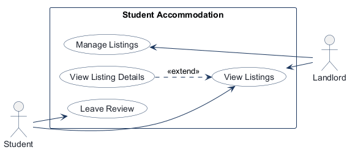
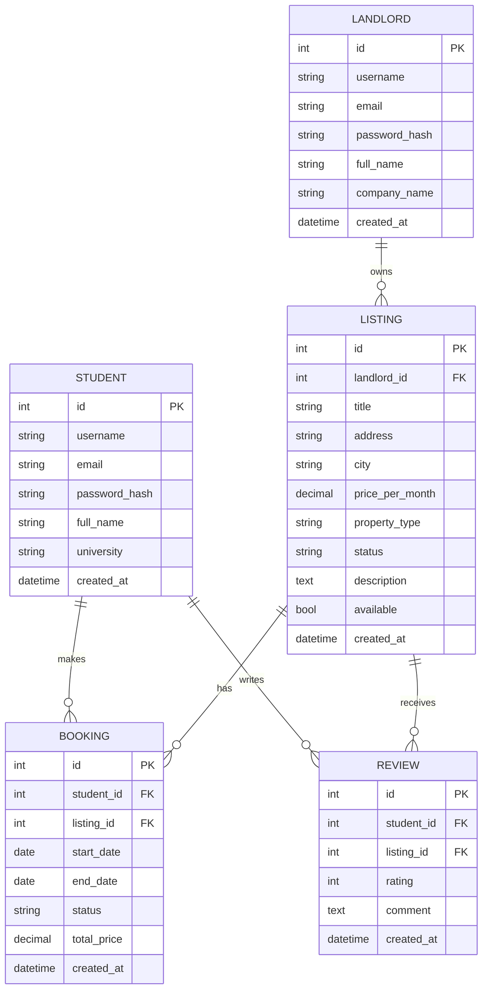
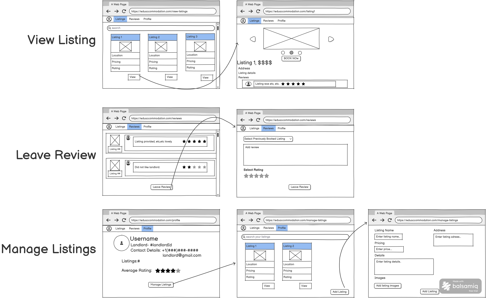

# COMP 3613 Assignment 1

Draft this file with the Guide. **Update it after every phase milestone** before you pause. The use-case diagram is a UML PNG at `docs/diagrams/use-case.png`, linked from this file as `diagrams/use-case.png` (path relative to `docs/report.md`). The model diagram is Mermaid. **Embed wireframe images** as `wireframes/<file>` (files live in `docs/wireframes/`).

Do not put your student ID in this file if you will commit it. The PDF cover adds your name and ID at export time.

## Assigned project

Student Accommodation

## Three workflows

### 1.
View Listings (Student)

### 2.
Manage Listings (Landlord)

### 3.
Leave Review (Student)

## Use case diagram

View Listings is shared by Student and Landlord. View Listing Details is a separate use case that optionally extends View Listings; Leave Review remains separate. Manage Listings is associated with Landlord, and Leave Review with Student.

## Model diagram

First draft. Update this section in Phase 5 when polish revises the model, and note what changed.

Assumption: `Student` and `Landlord` are separate entities with their own profile data; each Listing is owned by one Landlord and can have many Reviews and Bookings, while a Student can write many Reviews and create many Bookings.

## Wireframes

### Student Accommodation overview

<!-- student-build:wireframe-coverage
use_case: View Listings
image: docs/wireframes/accomodationplatform.png
covered: yes
-->

<!-- student-build:wireframe-coverage
use_case: Manage Listings
image: docs/wireframes/accomodationplatform.png
covered: yes
-->

<!-- student-build:wireframe-coverage
use_case: Leave Review
image: docs/wireframes/accomodationplatform.png
covered: yes
-->

### Phase 4 model notes

- LISTING.price_per_month — seen on the listing cards and detail screens; keep a numeric monthly price field with currency formatting.
- BOOKING.status — implied by the booking flow and listing detail; add a lifecycle state such as pending/confirmed/complete to match the workflow outcome.
- REVIEW.rating — seen on the review form; keep a 1-5 score that is validated on submit.
- LISTING.property_type / city / available — visible in the listing cards and list management screens; these fields should remain in the model for filtering and availability states.

The combined wireframe covers the three named workflows, but the post-submit path is still implicit: after a student books or leaves a review, the flow outcome is not shown. The design is usable, but the completion screen or confirmation state should be clarified before implementation.

## Theming

- **Colors:** Blue (`#1E4E8C`), gold (`#C9A227`), black (`#0A0A0A`)
- **Type:** Modern (DM Sans)
- **Tone:** Professional
- **Logo or wordmark:** Wordmark only (`StudentNest`); no logo

Applied as CSS tokens in `app/static/css/app.css` and carried through landing, login, register, and the authenticated shell. The starter dashboard demo at `/app` was removed; signed-in users go to listings. `/config` is kept.

## Implementation notes

### View Listings (Student)

Choice: listing grid and details are public; booking still requires sign-in.

<!-- student-build:code-check
workflow: View Listings (Student)
form: choice
layer: other
architecture_ok: yes
implement_confidence: 0.72
passed: yes
note: Student picked public listing grid; booking remains signed-in.
-->

<!-- student-build:code-check
workflow: View Listings (Student)
form: snippet
layer: model
architecture_ok: yes
implement_confidence: 0.65
passed: yes
note: Student added LISTING.created_at from the ERD; Guide kept PK on the table class.
-->

<!-- student-build:code-check
workflow: View Listings (Student)
form: snippet
layer: router
architecture_ok: yes
implement_confidence: 0.64
passed: yes
note: listings_view constructs AccommodationService(ListingRepository) and calls list_listings; no SQL in the route.
-->

<!-- student-build:code-check
workflow: View Listings (Student)
form: snippet
layer: repository
architecture_ok: yes
implement_confidence: 0.68
passed: yes
note: get_all used select(Listing) via db.exec in the repository; Guide added search filters to match the wireframe.
-->

Public `/listings` grid with search and View → detail. Booking on detail stays signed-in. Demo listings seed with landlord / landlordpass.

## Deployed app

Phase 6. Public Render URL (not localhost). Markers open this to mark the three workflows.

https://

## Logins

Every account a marker needs, including extra users you added. Starter accounts:

- bob / bobpass — regular user
- admin / adminpass — admin
- landlord / landlordpass — listing owner

## YouTube URL

## Session transcripts

Filled when the Guide builds the report: the agent writes each Guide chat to `docs/transcripts/<slug>.md` (Copilot Agent, Cursor, or OpenCode). `python manage.py report` packages them. Do not paste chats here during the build.

## Competency (student-judge)

Filled when the report is built. Guide runs student-judge, writes `docs/judge.md`, and export appends the scorecard here.

## Skill integrity

Filled by `python manage.py report`. Do not edit the course skills.
